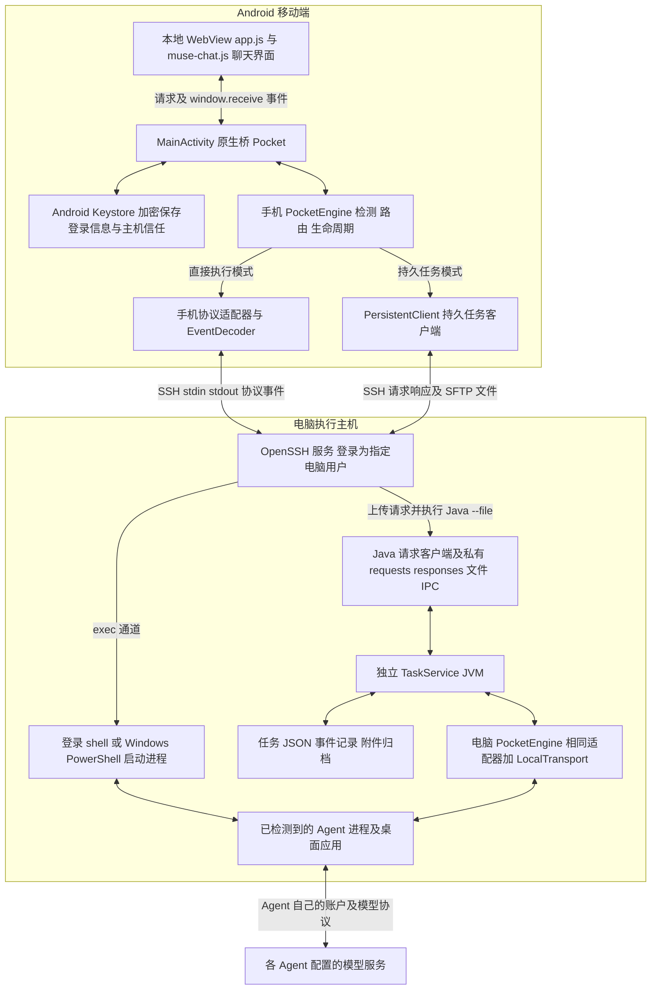
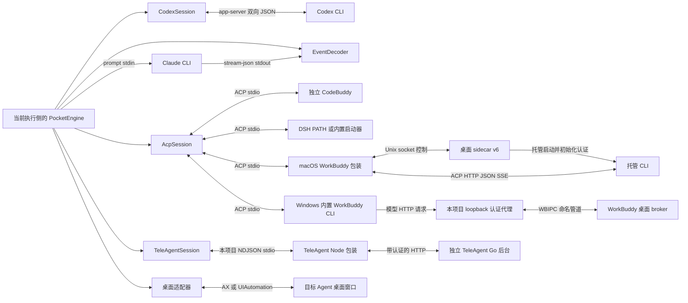
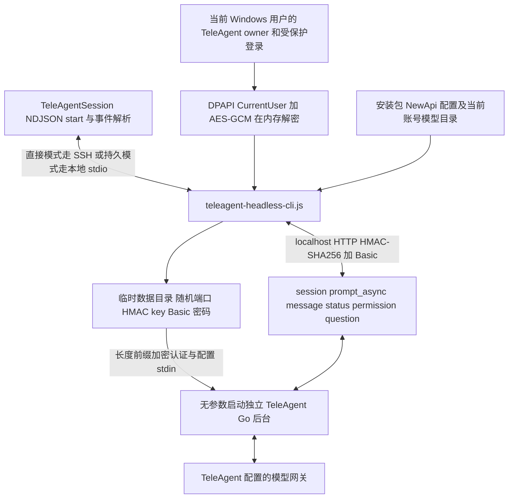
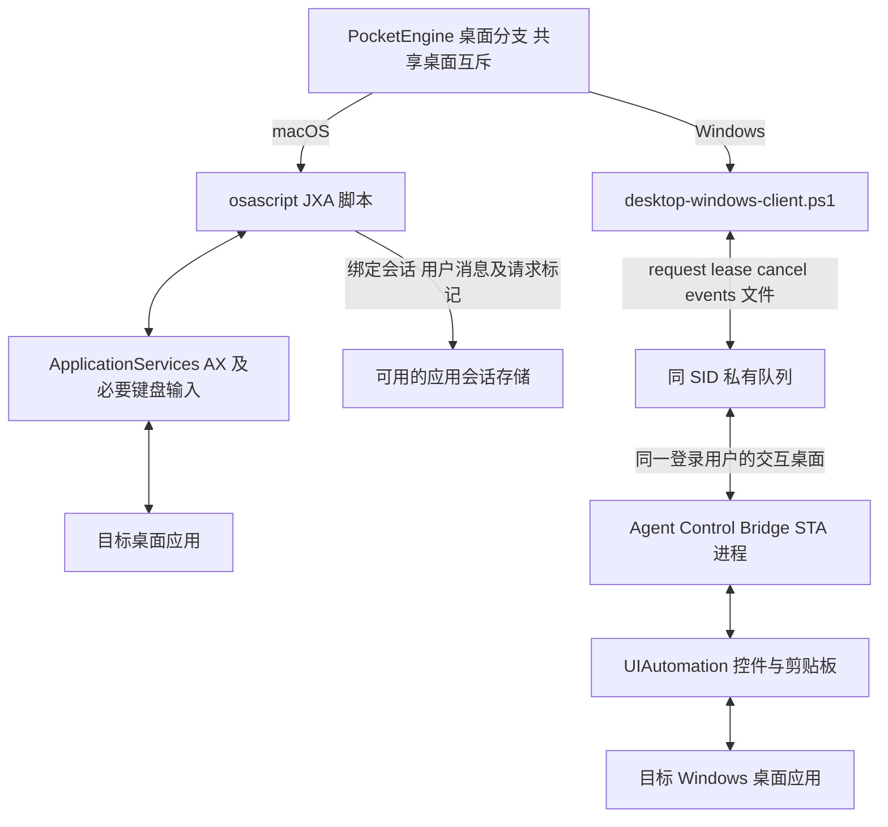
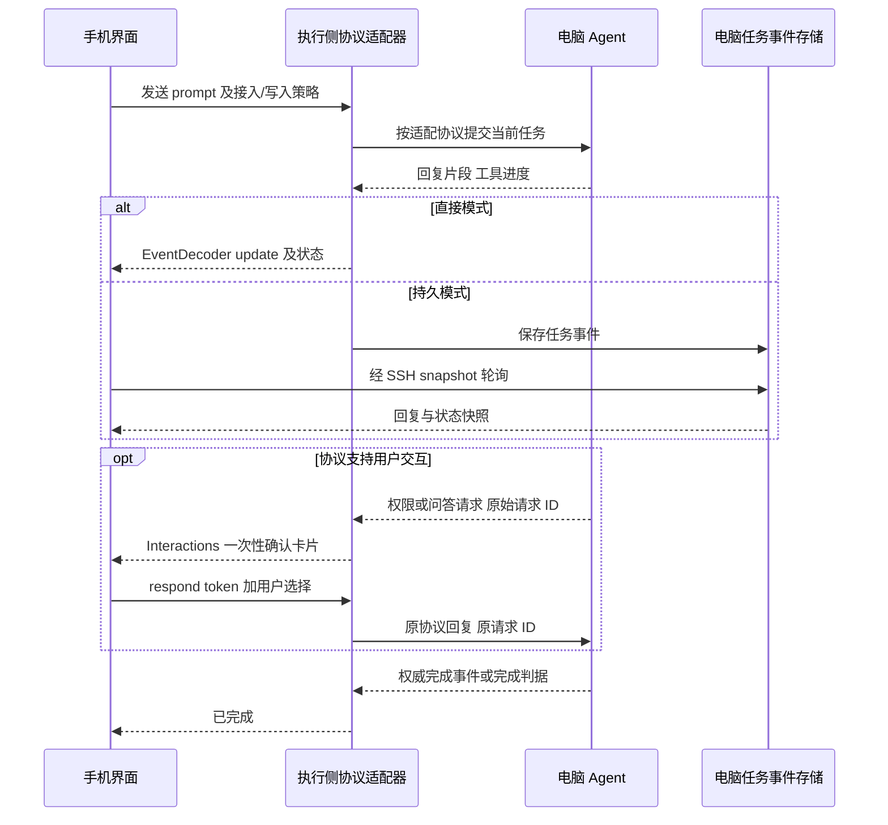

# 移动端与电脑 Agent 通信架构

依据当前 0.5.22 源码梳理，日期为 2026-10-12。手机统一提供聊天、任务状态、确认和附件界面；电脑负责运行 Agent，以及由 Agent 访问自己的模型服务。手机与电脑之间统一使用 SSH/SFTP，电脑内部则有五类不同的 Agent 通信协议。

需要分开理解三层：**SSH 是手机与电脑之间的传输和身份认证；协议适配器负责与 Agent 交换消息；Agent 自己的登录和模型配置决定能否调用模型。** SSH 登录成功不等于 Agent 登录成功。

## 1 总体架构和两种执行位置

直接模式的协议解析器运行在手机：手机经 SSH 启动电脑进程，然后持续读取其 stdout，并按需向 stdin 回传确认。持久模式的协议解析器运行在电脑：TaskService 复用 PocketEngine，通过 LocalTransport 在本机启动进程，手机轮询已保存的任务事件。两种模式使用同一套 Agent 适配逻辑。

当前移动端默认开启持久任务服务，也可以关闭后使用直接模式。`muse-chat.js` 包装聊天与事件处理，持久快照按任务事件 seq 去重恢复；不因恢复界面重新提交任务。

Windows 的长脚本通过 SFTP 上传临时 `.ps1` 文件执行，避免命令行长度和 OpenSSH stdin 截断；需要的 Node 模块由启动脚本写入临时文件。macOS/Linux 使用登录 shell，macOS 桌面脚本另经 stdin 传给 `osascript`。

电脑持久任务服务不新增面向手机的 HTTP 或 WebSocket 监听端口。手机无需直连 WorkBuddy、TeleAgent 或桌面桥接的内部接口。

电脑地址必须从手机网络可达，例如同一局域网或可达 VPN；SSH 端口默认 22，可在连接设置修改。项目的手机到电脑链路不经过云中转服务。SSH 主机公钥指纹用于核对电脑身份，登录使用所选电脑用户的密码或私钥。

## 2 每个 Agent 的通信方案

下表中的“外层”指直接模式的 SSH 标准输入输出；持久模式将这一层替换为电脑本地进程标准输入输出，表中 Agent 协议保持一致。

| Agent 与平台 | 启动和消息协议 | 电脑内部额外通信 | 登录与运行依赖 | 完成与交互 |
|---|---|---|---|---|
| Codex，Windows/macOS/Linux | `codex app-server --listen stdio://`；双向逐行 JSON 请求、响应和通知 | 当前主链无需额外本地 HTTP 服务 | 电脑执行用户的 Codex 登录和配置 | `turn/completed` 且状态为 completed；手机可返回命令/文件修改批准和用户问答 |
| Claude Code，Windows/macOS/Linux | `claude -p --verbose --output-format stream-json`；prompt 输入 stdin，JSON 事件输出 stdout | 当前主链无需本地托管接口 | Claude CLI 自身登录、服务地址及环境配置 | `result` 与 `is_error`，并检查进程退出；当前没有 CLI 确认/问答回传适配 |
| 独立 CodeBuddy，Windows/macOS/Linux | `codebuddy/cbc --acp --permission-mode default`；ACP v1 JSON-RPC 双向 stdio | 无本项目托管 HTTP 或命名管道 | 独立 CLI 自身登录；与 WorkBuddy 桌面登录分开 | `session/update` 加 `end_turn`；手机仅回传 allow_once/reject_once 权限选择 |
| WorkBuddy 内置 CLI，macOS | 手机端使用 ACP；Node 包装转为 ACP HTTP JSON/SSE | 同用户 Unix socket sidecar v6 → `session.create` → 桌面托管 CLI → 随机 loopback ACP HTTP 端点 | 系统 Node；WorkBuddy 桌面已登录、运行，由桌面初始化子进程认证 | 手机仍由 AcpSession 处理完成和单次权限确认 |
| WorkBuddy 内置 CLI，Windows | Node 启动内置 CLI `--acp`；ACP 直接经 stdio 传输 | CLI 模型请求 → 随机 loopback HTTP 认证代理 → WBIPC 命名管道 → 桌面 broker 的 `wb.request` | 系统 Node；WorkBuddy 桌面已登录、运行；broker 保留账户 token | ACP 回复及 end_turn；支持单次权限选择；HTTP 认证代理通过完整 body_b64 缓冲回复 |
| DeepSeek Harness 的 PATH CLI，Windows/macOS/Linux | `dsh acp`；ACP v1 JSON-RPC 双向 stdio | 没有本项目附加的托管 HTTP/pipe | DSH 自身 profile 和凭据；需开启“使用电脑现有权限” | ACP end_turn 和单次权限选择 |
| DeepSeek Harness 内置 CLI，macOS/Windows | Electron 的 Node 模式启动包装脚本及 ACP profile；外层为 ACP stdio | 读取桌面模型选择，必要时生成临时模型 patch；没有 WorkBuddy 式桌面认证 broker | DSH 自身凭据；显式 ACP 模型优先，否则沿用桌面 provider/model；需开启电脑现有权限 | 与 PATH DSH 相同 |
| TeleAgent 后台 CLI，Windows | TeleAgentSession ↔ 本项目 Node NDJSON 包装 ↔ 独立 Go 后台 HTTP | 长度前缀 stdin 初始化；HTTP HMAC+Basic；创建 session、提交消息、轮询回复及交互 | 系统 Node、已安装 TeleAgent；同一 Windows 用户已保存有效的 TeleAgent 登录 | 本项目 snapshot/tool/permission/question/done 事件；支持一次允许/拒绝和问答 |
| TeleAgent，macOS | 当前使用桌面适配；没有接入本次 Windows HTTP 包装 | JXA/AX 与按请求绑定的桌面会话数据读取 | 已登录的桌面应用、辅助功能授权、可交互桌面 | 桌面完成及交互事件，能力依具体适配 |
| 豆包，macOS/Windows | 当前只有桌面适配 | macOS JXA/AX；Windows 私有文件队列 → 交互桌面 Bridge → UIAutomation | 已登录、解锁的桌面；Windows Bridge 或 macOS 系统授权 | 读取桌面回复和完成；Windows 的确认/附件不具备 macOS 同等验收范围 |

Codex、Claude、WorkBuddy、DeepSeek 的已检测桌面对象还可以被显式选择为“直接桌面”，或在默认接入符合条件时作为备用。它们由通用桌面分支执行，不沿用上表的 CLI 协议。Linux 当前只有 PATH CLI 检测，没有这些桌面适配分支；安装独立 CodeBuddy 时以 CodeBuddy 身份接入。

当前正常 Codex 路径是 **app-server**。`Agent.shell()` 还保留 `codex exec --json`、`buddy -p stream-json`、`dsh headless` 的旧 helper，但 PocketEngine 会先进入 CodexSession 或 AcpSession 分支，不能用这些残留参数描述当前主链。

## 3 五类 Agent 协议分支

WorkBuddy 的 macOS 与 Windows 不能画成同一条 HTTP 链。macOS 的 HTTP 承载 ACP 会话；Windows 的 ACP 本身直接走 stdio，其额外 HTTP 代理用于让桌面 broker 认证模型请求。这两个托管方案都不依赖点击聊天窗口。

“Agent Control Windows Bridge”与“WorkBuddy 桌面 broker”也是两个不同组件：前者是本项目的桌面 UI 自动化进程；后者属于 WorkBuddy，负责其内置 CLI 的账户认证。

## 4 TeleAgent 的独立后台细节

原生 TeleAgent 运行时无参数启动服务，仅发现 `export` 子命令；不存在已验证的 `chat`、`run`、ACP 或 `server` 子命令。手机可“仅 CLI”对话，是因为本项目提供了标准输入输出包装，并调用后台 HTTP API。

每次任务新建临时数据/config/cache 目录和独立数据库，不接管桌面后台。认证读取会核对当前 owner、登录代次、安装代次和 token 指纹；注销、切换账号或凭据改变会拒绝继续。解密的账户 token 不返回手机、不打印、不作为明文配置保存；它在初始化阶段被重新加密，通过子进程 stdin 交给后台。

Node 的全部 HTTP 请求访问 `127.0.0.1`。Go 后台自身监听 wildcard 地址，业务 API 强制随机 HMAC 和 Basic 认证；`/ready` 是公开就绪检查。它并非仅绑定 loopback 的服务。

提交使用 `POST /session` 和 `POST /session/{id}/prompt_async`。后台生成消息 ID，包装再绑定本次用户消息；约每 300ms 读取 message、status、permission 和 question。当前实现使用 HTTP 轮询，未消费 TeleAgent 的 SSE `/event`。只有会话和父消息匹配、后台 idle、消息完成、工具不再运行、没有未回答请求，并二次读取确认后才完成；先清理后台，再发 `done`。

权限返回 `POST /permission/{id}/reply`，只允许 once/reject。问题返回 `POST /question/{id}/reply` 或 reject，支持选项、多选和自由文本。未开启写入时拒绝写入与命令；开启后写入及 PowerShell 要确认；Bash 与工作目录外操作拒绝。取消/EOF/断线清理仅针对自建 session 和进程树，不操作桌面原有任务。

## 5 桌面自动化分支

Windows SSH 服务与登录桌面处于不同会话，SSH 进程不能直接替代交互桌面的 UIAutomation 操作。因此需要已解锁的用户桌面 Bridge。队列默认在 `%ProgramData%/AgentControl/<用户 SID>/bridge`，旧版用户目录仅作兼容；以 ACL、broker 实例 ID、请求时效与 lease 限定请求，不新增网络监听端口。Bridge 串行操作控件并写 JSON 事件，SSH 侧读 events 文件回传。

剪贴板用于粘贴提示词，回复从 UIAutomation 文本中提取；Copy 按钮只辅助识别回复边界与状态。队列的 cancel 或失效 lease 会停止桥接操作，但不能证明已经提交的桌面模型任务被中断。持久模式的 lease 由电脑后台客户端刷新，不随手机退出失效。

macOS 的脚本通过 AX 识别窗口、输入、确认和状态。WorkBuddy、TeleAgent 优先读取绑定本次请求的 JSONL 或只读 SQLite 会话数据，其他应用主要从 AX 提取。桌面 conversationId 用于定位同一手机聊天对应的电脑会话。桌面路线依赖当前应用版本、授权及可交互会话，不能等同于稳定的后台聊天 API。

Windows 当前主要适配文本收发；macOS 已有更丰富的确认、附件和桌面回查逻辑。具体能力及实测范围见 [确认和附件说明](RICH-INTERACTIONS.md) 与 [Windows 接入](LOCAL-WINDOWS-SETUP.md)。

## 6 回复 确认 附件的回流

适配器将原始事件归一为消息、状态、interaction、attachment 和 agentSession。直接模式经 MainActivity 的 `window.receive` 进入 WebView；持久模式由 TaskService 保存事件，再由 `serviceSnapshot` 更新手机。

交互能力并不完全相同：Codex 支持审批和问答；ACP 当前只实现单次权限选择，其他反向 RPC 返回不支持；TeleAgent 支持审批和问答；Claude 当前没有 CLI 反向交互通道。macOS 桌面另有重新校验控件后返回确认的链路，Windows Desktop Bridge 尚没有对应 interaction/panel 实现。完成事件分别为 Codex turn completed、ACP end_turn、Claude result、TeleAgent 自定义 done、桌面 desktop.done。

附件先生成绑定 run/电脑身份的能力记录。电脑本地文件通过 SFTP 读取；持久模式尽量归档到私有 files 目录并记录 durablePath，二进制下载仍由手机经 SFTP 读取，不通过 TaskService 下载 RPC；内联图片可直接交给原生层。允许的豆包图片服务可由受限制的远程图片读取逻辑处理。手机原生层负责预览、读取授权及通过系统文件选择器保存，普通远程 URL 不会自动获得本地文件读取能力。

## 7 持久任务的生命周期

直接模式的 SSH 通道属于手机进程：退出 Activity 会关闭传输，断线不能证明 Agent 已停止或操作未发生，不自动重放原消息。确认能力随当前执行生命周期结束而失效。

持久模式上传按内容 SHA-256 命名的服务 JAR，再通过 `TaskService --file` 请求客户端与独立服务通信。服务用文件锁保持单实例，任务和事件存为 JSON；同一 conversationId 串行，全服务最多三个任务并行，桌面操作另共享互斥锁。手机约每三秒请求快照，断线后任务可继续运行，重连取结果。

| 电脑目录 | 保存内容 |
|---|---|
| `~/.agent-control/runtime` | 按哈希命名的服务 JAR，以及经 SFTP 上传、执行后删除的 rpc 请求文件 |
| `~/.agent-control/data/requests` 与 `responses` | Java 请求客户端与独立服务之间的本机文件 IPC |
| `~/.agent-control/data/tasks` | 任务 JSON、状态和事件记录 |
| `~/.agent-control/data/files` | 可归档的附件原始字节 |
| `~/.agent-control/data/service.log` | 独立服务进程日志 |

同 messageId 的请求内容相同可去重，内容不同会拒绝；服务重启后，原运行或等待确认任务标为状态待确认，旧审批失效，不自动重放。运行中的服务升级会等待空闲。当前不是系统推送通知，也不是恢复原生 Agent 对话：CLI 每任务新建 thread/session，持久服务将最近八轮成功历史作为文本上下文传入，保存原生会话 ID 供核对。TeleAgent 临时后台尤其不继承桌面历史、技能与全局记忆。

可选浏览器 worker 位于持久服务旁路：TaskService/BrowserBridge 使用带私有 token 的 loopback HTTP；Codex 可经 stdio MCP 的 BrowserMcp 调用只读网页工具。该浏览器能力不是 Agent 通信的基础设施，ACP 目前未挂载此 MCP 工具。

## 8 发现 选择和两层回退

连接先尝试 POSIX 检测，未完成才尝试 Windows 检测。独立 DSH PATH CLI 优先于内置 DSH；WorkBuddy 内置与独立 CodeBuddy 使用不同 Agent ID。Windows 内置 WorkBuddy/DSH 当前可使用同 SID Bridge 缓存的安装路径，发现 CLI 不要求 status 实时在线；实际桌面操作要求实时 Bridge。TeleAgent 另外支持有限注册表和指定开始菜单快捷方式发现，不依赖 Bridge 状态。

| 配置 | 作用 |
|---|---|
| `accessMode=auto` 默认接入 | 使用 inventory 中的 CLI 优先条目；符合条件时可回退同一个 Agent 的桌面路径 |
| `accessMode=cli` 仅 CLI | 排除桌面条目，并禁止同 Agent 桌面回退 |
| `accessMode=desktop` 直接桌面 | 选择该 Agent 已检测到的桌面对象 |
| `agent=auto` 自动调度 | TaskRouter 在候选名单中选择协调者、规划最多三个执行者，与接入方式是不同维度 |
| `taskService=true` | 将执行和协议解析移到电脑 TaskService；不会替某个 Agent 更换聊天协议 |

同 Agent 的桌面回退由 `PocketEngine.canFallback` 检查：必须尚未开始工作、桌面可用且未取消，只有明确认证拒绝/特定命令缺失允许回退；超时、断开、中断、状态未知拒绝回退。DSH 必须启用 hostPermissions，适配器未对它追加统一只读工具限制；不能把所有 Agent 的 write=false 视为相同的沙箱保证。

**当前自动换 Agent 仍有一个边界缺口。** `TaskRouter.unavailable` 用异常文本判断未就绪，没有携带 PocketEngine 的 workStarted/提交状态。例如 TeleAgent 提交后认证失效，虽然已阻止同 Agent 桌面回退，原异常仍可能含 Authentication required；自动调度的单执行者换人分支可能向下一位 Agent 重发。架构中的这两层回退尚未统一为提交状态判定。本次梳理仅记录该问题，没有修改程序或重新打包。

## 9 验证范围与代码入口

0.5.21 的 Windows WorkBuddy、DSH 已通过与手机相同的 Java SSH/SFTP 通道取得真实回复和 ACP end_turn。0.5.22 的 TeleAgent 已通过生产 PocketEngine → JSch SSH/SFTP → NDJSON → 独立 HTTP 后台取得真实文本回复和完成；Java 38 项、Node HTTP/生命周期 18 项及合成认证 13 项通过。Claude 本机 CLI 入口已修正，但已记录的模型请求仍因现有 API ConnectionRefused 未成功。

上述电脑端测试不能替代实体 Android 显示/点击验收。TeleAgent 真实模型权限问答、图片文件端到端仍待验收；各 Agent/platform 的桌面能力也不能互相代替。详情见 [当前 CLI 支持](CLI-SUPPORT.md)，旧的 [Orca 历史方案分析](ORCA-ARCHITECTURE.md) 不代表当前主链。

| 代码入口 | 职责 |
|---|---|
| [MainActivity](../android-app/app/src/main/java/dev/orca/pocket/MainActivity.java#L52) / [SecureStore](../android-app/app/src/main/java/dev/orca/pocket/SecureStore.java) | 本地 WebView、原生桥、window.receive、Keystore 保存 |
| [PocketEngine](../android-app/app/src/main/java/dev/orca/pocket/PocketEngine.java#L127) | 执行位置、Agent/接入选择、各协议启动和桌面回退 |
| [SshTransport](../android-app/app/src/main/java/dev/orca/pocket/SshTransport.java#L93) / [LocalTransport](../desktop-service/src/dev/orca/pocket/LocalTransport.java) | SSH/SFTP 临时脚本与 stdio，或电脑本地进程 |
| [CodexSession](../android-app/app/src/main/java/dev/orca/pocket/CodexSession.java#L30) | Codex app-server、审批、问答 |
| [AcpSession](../android-app/app/src/main/java/dev/orca/pocket/AcpSession.java#L16) / [Agent](../android-app/app/src/main/java/dev/orca/pocket/Agent.java#L32) | ACP，Claude stream-json 参数 |
| [WorkBuddy macOS 包装](../android-app/app/src/main/assets/workbuddy-acp-launch.js#L108) / [Windows 包装](../android-app/app/src/main/assets/workbuddy-windows-cli.js#L18) | sidecar 托管与 ACP HTTP；WBIPC 模型认证代理 |
| [DSH 包装](../android-app/app/src/main/assets/dsh-acp-launch.js) | 内置运行时、ACP profile、桌面模型 patch |
| [TeleAgentSession](../android-app/app/src/main/java/dev/orca/pocket/TeleAgentSession.java#L36) / [HTTP 包装](../android-app/app/src/main/assets/teleagent-headless-cli.js#L13) / [认证读取](../android-app/app/src/main/assets/teleagent-auth.js#L81) | NDJSON、隔离后台、HTTP 认证、受保护登录、权限问答 |
| [macOS 桌面聊天](../android-app/app/src/main/assets/desktop-chat.js) / [Windows 桌面客户端](../android-app/app/src/main/assets/desktop-windows-client.ps1) / [Bridge](../windows/Bridge.ps1) | AX、会话读取、文件队列和 UIAutomation |
| [PersistentClient](../android-app/app/src/main/java/dev/orca/pocket/PersistentClient.java#L59) / [TaskService](../desktop-service/src/dev/orca/pocket/TaskService.java#L192) / [TaskStore](../desktop-service/src/dev/orca/pocket/TaskStore.java) | JAR 发布、文件 RPC、队列、事件和断线恢复 |
| [Interactions](../android-app/app/src/main/java/dev/orca/pocket/Interactions.java) / [Attachments](../android-app/app/src/main/java/dev/orca/pocket/Attachments.java) | 一次性确认与附件能力 |
| [TaskRouter](../android-app/app/src/main/java/dev/orca/pocket/TaskRouter.java#L14) | 自动分工、并行分析、汇总，以及当前按文本判断的换人分支 |
